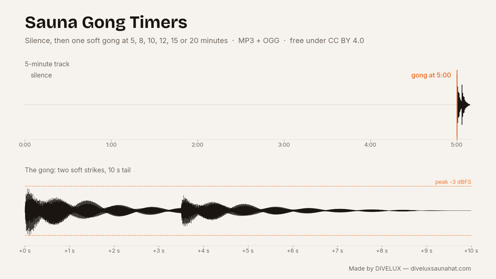

# Sauna Gong Timers

Six audio tracks for timing a sauna round: silence, then one soft gong. Press play when you sit down, and the gong
tells you the time is up. Lengths: 5, 8, 10, 12, 15 and 20 minutes.

Made by DIVELUX, makers of handmade wool sauna hats — https://diveluxsaunahat.com



## Files

| File | Length | Size |
|---|---|---|
| `sauna-gong-timer-05-minutes.mp3` / `.ogg` | 5:10 | 5.0 MB / 74 KB |
| `sauna-gong-timer-08-minutes.mp3` / `.ogg` | 8:10 | 7.9 MB / 94 KB |
| `sauna-gong-timer-10-minutes.mp3` / `.ogg` | 10:10 | 9.8 MB / 108 KB |
| `sauna-gong-timer-12-minutes.mp3` / `.ogg` | 12:10 | 11.7 MB / 121 KB |
| `sauna-gong-timer-15-minutes.mp3` / `.ogg` | 15:10 | 14.6 MB / 142 KB |
| `sauna-gong-timer-20-minutes.mp3` / `.ogg` | 20:10 | 19.4 MB / 175 KB |
| `gong-10s.wav` | the gong on its own, 10 s, 16-bit WAV | 0.9 MB |
| `src/build.py` | the script that makes everything | |

MP3: 128 kbps CBR, mono, 44.1 kHz. Ogg Vorbis: quality 4, mono, 44.1 kHz (the Ogg files are tiny because Vorbis
stores silence almost for free). Both are tagged: title, artist DIVELUX, album "Sauna Gong Timers", license, website.

## Timing

- The track is digital silence up to exactly N:00.
- The gong starts at N:00 (checked to within a few milliseconds after encoding). A second, softer strike follows
  3.5 seconds later, and the sound fades out by N:10. So each file is 10 seconds longer than its name.
- MP3 players may add a few milliseconds of encoder padding at the start. That does not change the timing in practice.

## The sound

The gong is synthesized: eight decaying sine partials (174 to 1012 Hz) with a soft mallet attack of about 50 ms,
no samples or recordings. Almost all of the energy sits between 100 and 400 Hz, so it is a low, warm tone rather than
a bright bell. Peak level is −3 dBFS on the WAV (about −3.4 dBFS after MP3 decoding), with no clipped samples.
Start at a low volume; it is meant to be heard across a quiet room, not to startle anyone.

## How to use

- Keep the phone, tablet or speaker outside the hot room. Electronics do not belong in the heat.
- Choose the length that suits you. Shorter rounds are fine; leave the heat any time you feel unwell.
- Loop a track in your player for repeated rounds, or make a playlist with rest breaks in between.

General information, not medical advice.

## Rebuild

```
pip install numpy mutagen matplotlib
python3 src/build.py          # all six lengths, or: python3 src/build.py 5 10
```

Needs ffmpeg with libmp3lame and libvorbis. The script runs one ffmpeg process at a time (`nice -n 10`), tags the
files, then decodes each file back and checks length, silence before N:00, gong start and peak level.

## License

Audio: CC BY 4.0 (Creative Commons Attribution 4.0 International). Credit: "Sauna Gong Timers by DIVELUX —
diveluxsaunahat.com". Script: MIT. The DIVELUX name and logo are not covered by the license. See `LICENSE`.

More free sauna tools: https://diveluxsaunahat.com/pages/sauna-tools
